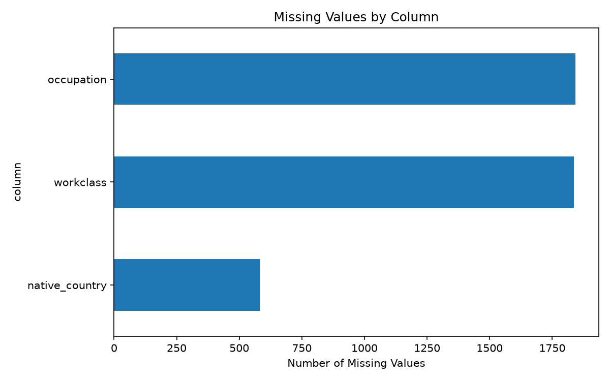

# Is This Data Trustworthy? A Reproducible Data Quality Audit

A Python/Pandas audit of the UCI Adult Census Income dataset. The project measures data quality, applies documented cleaning rules, and compares the data before and after cleaning.

## Dataset
- Source: https://archive.ics.uci.edu/dataset/2/adult
- File used: `adult.data` (training split only, 32,561 records, 15 columns)
- The original file is never modified. Cleaned output is written to `reports/`.

## Project structure
```
data-trust-audit/
├── data/adult.data
├── reports/
├── src/audit.py
├── requirements.txt
└── README.md
```

## How to reproduce
1. Place `adult.data` in `data/`.
2. Create and activate a virtual environment, then install dependencies:
```
   pip install -r requirements.txt
```
3. Run from the project root:
```
   python src/audit.py
```

## Audit rules
| Dimension | Check |
|---|---|
| Completeness | Missing values per column (`?` treated as missing) |
| Uniqueness | Exact duplicate rows |
| Consistency | Whitespace and capitalization variants in text columns |
| Validity | Age outside 17-100; hours per week outside 1-100 (assumed limits) |
| Integrity | Each `education` label maps to exactly one `education_num` |
| Outliers | IQR rule (1.5 x IQR), flagged for review only |

The raw file was read without trimming whitespace, so formatting problems stayed visible to the audit.

## Cleaning decisions
- Trimmed leading and trailing whitespace in text columns.
- Removed exact duplicate rows.
- Kept missing values. No imputation was applied.
- Kept flagged outliers. They need investigation, not automatic deletion.

## Results
| Metric | Before cleaning | After cleaning |
|---|---|---|
| Total records | 32,561 | 32,537 |
| Exact duplicate rows | 24 | 0 |
| Missing cells | 4,262 | 4,261 |
| Rows with at least one missing value | 2,399 | 2,398 |
| Invalid age records | 0 | 0 |
| Invalid working-hours records | 0 | 0 |
| Category values with extra whitespace | 288,787 | 0 |
| Education label/code conflicts | 0 | 0 |

Missing values by column:

| Column | Missing | Percent |
|---|---|---|
| occupation | 1,843 | 5.66% |
| workclass | 1,836 | 5.64% |
| native_country | 583 | 1.79% |



## Findings
**How many rows were removed, and why?**
24 rows (0.07%) were exact duplicates and were removed, leaving 32,537. The dataset has no record ID, so some duplicates could be different people with identical values. The effect on results is very small.

**Which columns had the most missing values?**
`occupation` (1,843), `workclass` (1,836) and `native_country` (583). In total, 4,262 cells (0.87% of all cells) were missing, affecting 2,399 rows (7.37%). `workclass` and `occupation` were missing together in 1,836 rows, so the gaps are clustered, not random.

**Did standardizing category formatting change the number of unique categories?**
No. Every column had the same number of unique values before and after trimming and lowercasing. The 288,787 whitespace issues come from a leading space in the file's ", " separator, which is a file-format artifact, not a data-entry error.

**Which flagged values were genuine errors, and which were valid but unusual?**
No record violated the age or working-hours rules. `capital_gain` is 0 for 29,849 rows, and 159 rows have the value 99999. This is likely a capped or coded value, not a real amount, so these rows were kept and flagged for review. Other IQR outliers (see `reports/outlier_review.csv`) are valid but unusual values, not confirmed errors.

**How might the cleaning decisions affect downstream analysis?**
Very little in this case. The income split moved from 75.92% / 24.08% to 75.91% / 24.09%, and mean weekly hours from 40.437 to 40.44. The main risk for later analysis is the clustered missing data in `workclass` and `occupation`. Dropping or imputing those rows could change results.

## Limitations
- Only the training split is audited, not the full 48,842 records.
- The age and hours limits are lenient assumptions. Passing them does not prove the values are correct.
- Duplicates were identified without a unique ID.
- Missing values were not imputed. The right treatment depends on the analysis.
- The cause of the missing values is unknown.

## Output files (`reports/`)
- `audit_summary.csv`: before/after quality metrics
- `missing_values.csv`: missing counts and percentages
- `category_consistency.csv`: formatting consistency by column
- `outlier_review.csv`: IQR bounds and flagged counts
- `income_before_after.csv`: income distribution before and after cleaning
- `cleaned_data.csv`: cleaned dataset
- `missing_values.png`: missing values chart